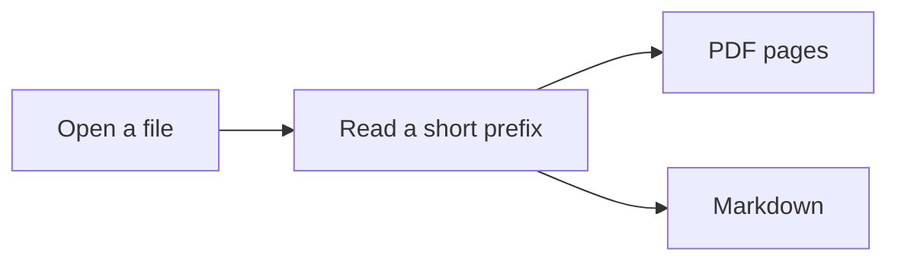

# Reading without the extra machinery

Reader opens one document at a time. The format comes from the bytes at the start of the file, so a PDF named `notes.md` is still a PDF.

## What you can do

- Scroll, search, and jump by heading.
- Switch this note between rendered and raw with `Ctrl/⌘ E`.
- Keep remote images off until you explicitly allow them.

| Feature | Loads when |
| --- | --- |
| Markdown text | The file is text |
| Diagrams | A mermaid fence exists |
| Math | A math span exists |

- [x] Open from the command line
- [ ] Annotate a PDF copy

> [!NOTE]
> Source files are never rewritten. Raw view is the exact text.

A local mark sits beside the prose:


External pages stay behind a confirmation: [Project site](https://github.com/).

```javascript
function openDocument(path) {
  return path;
}
```

Inline math such as $E = mc^2$ stays in the sentence.

$$
\int_0^1 x^2 \, dx = \frac{1}{3}
$$



An unknown fence stays plain:

```
not really a language
```

Footnotes still belong to the note.[^1]

[^1]: Rendered only in rendered mode. The raw file is unchanged.
